# DSH 图片转 CAD 插件

把 JPG 或 PNG 工程图交给 DSH，插件提供局部读图、建模、DXF 导出、独立审图和返修工具。DSH 从栅格图重建几何，可以导出可编辑的 DXF。

## 三个插件

- [原版 0.2.0](plugins/original)提供早期制图与自检流程。运行原版需要自行配置兼容的旧识图服务。
- [降本版 0.3.6](plugins/cost)支持 DSH 直接读图和独立审图，保留每对话的估算预算与审图限次。
- [简易入口 1.0.0](plugins/easy)沿用降本流程。上传图片后说「帮我做成 CAD」即可进入制图流程。

在 Windows 上按[安装说明](docs/INSTALL.md)生成本机配置，从 DSH 插件库启用其中一个版本。工具链与交付条件见[运行流程](docs/WORKFLOW.md)。

## 真实栅格输入的局部对比

左起为**原始栅格图局部 → 接入这三款插件前的旧流程 → 插件早期候选 → 插件返修后**。旧流程依靠 Codex 编写的零件配方，DSH 负责调用与导出。插件阶段的几何由 DSH 自行重建。现存记录缺少同一输入、仅使用 DSH 默认能力的严格无插件对照。

**JPG · 槽端尖角**  
早期插件候选的斜线在边界截断，返修后补齐了原图中的尖端。

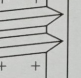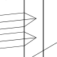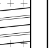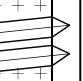

**JPG · V 槽轮廓**  
原图中的成对 V 槽在返修稿中保留了轮廓和尖端。

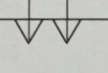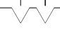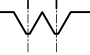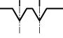

**PNG · 重复槽线**  
早期候选的密集线条难以分辨。返修稿增加了局部放大视图，可以检查各组线条和底部尖端。

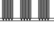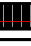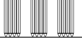

以上图块裁自真实 JPG、PNG 的输入或生成预览，显示尺寸统一到便于查看的大小，不能用于测量。返修示例有人工复核记录。简易入口已验证插件注册和缺图提示，完整的真实新图回归仍待补充。
